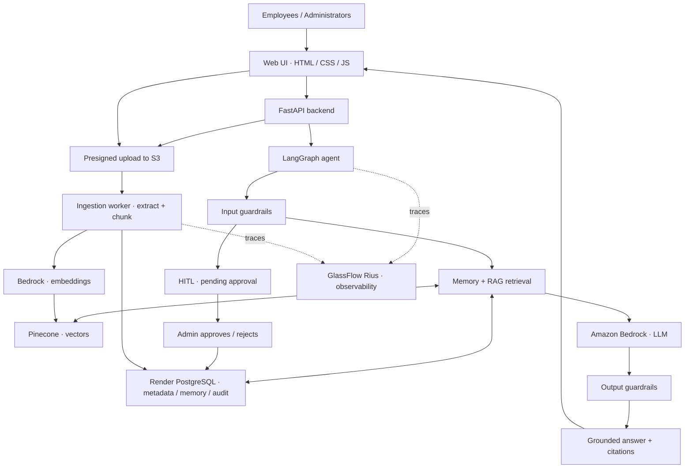
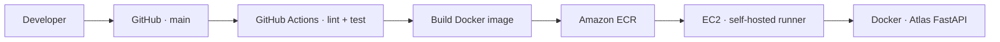

# Atlas Enterprise AI | Enterprise-QA-module

An enterprise knowledge copilot being built to let employees search organizational documents, ask follow-up questions, and receive grounded answers with citations. The target system combines RAG, LangGraph, guardrails, human-in-the-loop approvals (HITL), and GlassFlow Rius observability.

**Current stage:** Infrastructure and application foundation. The diagrams below describe the **target architecture**, not a deployed system.

## Target application architecture



**Document path:** Browser → S3 → ingestion worker → Bedrock embeddings → Pinecone; PostgreSQL tracks document status.

**Chat path:** Browser → FastAPI → LangGraph → input checks → conversation memory/retrieval → Bedrock generation → output checks → grounded response. Sensitive requests enter a human approval queue; decisions are recorded rather than automatically executing destructive actions.

## Target CI/CD deployment on AWS



GitHub Actions is intended to build and push a versioned image to ECR, then deploy it by pulling and restarting the container on EC2. This pipeline is planned; Dockerfile, workflows and deployment resources are not yet present.

## Technology stack

| Layer | Technology |
| --- | --- |
| Frontend | HTML, CSS, JavaScript |
| API | Python 3.12, FastAPI, Uvicorn |
| Agent | LangGraph |
| Document storage | Amazon S3 |
| Models | Amazon Bedrock: embeddings and chat |
| Vector search | Pinecone |
| Relational storage | Render PostgreSQL |
| Governance | Python guardrails, HITL, audit events |
| Observability | GlassFlow Rius |
| Deployment (target) | GitHub Actions, Docker, Amazon ECR, Amazon EC2 |

The original design specifies Titan V2 (1024 dimensions) and Nova Lite. The checked-in application instead defaults to Cohere Embed v4 and Nova 2 Lite inference profiles, with differences in the environment template. Resolve model compatibility before integration; see the [setup guide](development_steps/08-complete-setup-and-testing-guide.md).

## Getting started

From the repository root:

```powershell
conda create -n atlas python=3.12 -y
conda activate atlas
python -m pip install -r requirements.txt
Copy-Item .env.example .env
```

Fill the local environment with your own credentials. Never commit .env. After configuring PostgreSQL, initialize the schema:

```powershell
python scripts/init_db.py
```

The Bedrock smoke test is `python Test/test.py` (use compatible model IDs). FastAPI startup is a later milestone because app/main.py is currently empty.

## Development roadmap

| Phase | Scope | Status |
| --- | --- | --- |
| 1 | Environment, cloud setup, PostgreSQL, AWS clients, Pinecone | In progress |
| 2 | Ingestion, RAG, memory, guardrails, LangGraph and HITL | Planned |
| 3 | Rius observability and tracing | Planned |
| 4 | FastAPI, browser UI and integration | Planned |
| 5 | CORS, automated tests and end-to-end validation | Planned |
| 6 | Docker, GitHub Actions, ECR, EC2 deployment | Planned |

## Development documentation

Start with the [development handbook](development_steps/README.md).

- [Complete setup and testing guide](development_steps/08-complete-setup-and-testing-guide.md)
- [Render PostgreSQL and VS Code SQLTools](development_steps/09-render-postgresql-vscode-sqltools.md)
- [Step-by-step implementation order](development_steps/10-atlas-implementation-steps.md)
- [AWS CI/CD and deployment plan](development_steps/11-aws-cicd-deployment.md)
- [Verified code checkpoint and known gaps](development_steps/07-progress-and-validation.md)

Tenant identifiers are present in the data model, but production-grade authentication, authorization and tenant isolation are not yet implemented. Live cloud resources and successful execution have not been independently verified.
