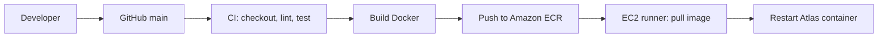

# AWS CI/CD deployment — target architecture

Based on the supplied Atlas Enterprise AI CI/CD deployment architecture. The target uses GitHub Actions to check code, build and publish a Docker image to Amazon ECR, and deploy to an Amazon EC2 instance hosting a self-hosted runner and the FastAPI container.

**Status: planned.** No Dockerfile, GitHub Actions workflow, ECR provisioning or EC2 deployment script is present in the current repository.

## 1. Containerize the application

Once FastAPI is implemented, create a Dockerfile using the Python 3.12 application environment. Install dependencies, copy the required runtime files, run Uvicorn, and add a .dockerignore excluding .env, virtual environments, caches and credentials. Smoke-test the container locally before publishing.

## 2. Configure Amazon ECR

Create a private repository for Atlas container images in the chosen AWS region. Grant scoped build/push and runtime pull permissions. Tag images with the Git commit SHA for traceability and rollback; avoid relying solely on latest.

## 3. Prepare EC2

Provision an EC2 instance with a supported OS, install Docker, configure the runtime IAM role and ensure the instance can pull from ECR. Set up the self-hosted GitHub Actions runner as intended in the reference diagram, with restricted privileges and an appropriate network/security-group configuration.

**Security consideration:** this repository is public. Do not run untrusted pull-request code on the persistent self-hosted deployment runner. Restrict deployment to trusted protected branches and approved environments; use isolated CI runners for untrusted changes. This is a recommended safeguard beyond the supplied diagram.

## 4. Implement continuous integration

Add a workflow under .github/workflows/. On appropriate pull requests/pushes, check out the code, install dependencies, lint and run automated tests. CI must not print credentials or depend on production data. Stop the pipeline if validation fails.

## 5. Implement continuous delivery

After successful CI on trusted main commits, authenticate to AWS using scoped short-lived credentials (such as a GitHub OIDC role), build the Docker image, tag it with the commit SHA, and push it to ECR. Preserve the image tag or digest for deployment.

## 6. Implement continuous deployment

The trusted deployment job on EC2 pulls the approved image, supplies runtime configuration securely, and starts or replaces the Atlas FastAPI container. Add health checks and verify readiness before marking the deployment successful. If startup fails, roll back to the previous known-good image. Do not bake secrets into images.

## 7. Validate the deployed application

Confirm API readiness, document upload and processing, grounded chat, approval decisions, and Rius traces. Confirm HTTPS, exact S3 CORS origins, access restrictions, logs without sensitive content, and restart/rollback behavior. Record the deployed image digest and corresponding Git commit.

The detailed implementation sequence above is a proposed realization of the diagram, not evidence of deployed AWS resources. Exact runner strategy, networking and exposure choices should be finalized before provisioning.
