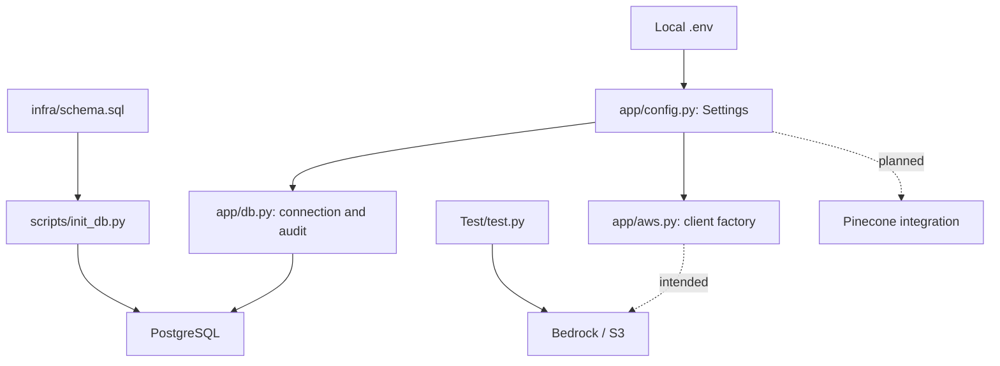

# Development steps — Enterprise QA (Atlas)

Snapshot: 19 November 2026, based on [source commit dea3d34](https://github.com/jarharsh1/Enterprise-QA-module/commit/dea3d34dc312f0364d12c871eaaacfd73b16cd80). This directory explains what has been built, why it exists, and how to reproduce and validate it. It is a code-based record, not evidence of a live cloud deployment.

## Read in this order

| Step | Guide | Status at snapshot |
| --- | --- | --- |
| 01 | [Project structure and environment](01-project-structure.md) | Implemented scaffold and dependencies |
| 02 | [Cloud infrastructure and Bedrock smoke tests](02-infrastructure-and-bedrock.md) | Configuration and test script present; provisioning not independently verified |
| 03 | [Centralized configuration](03-application-configuration.md) | Implemented; mismatches identified |
| 04 | [PostgreSQL schema and initialization](04-database-foundation.md) | Implemented SQL and initializer; live execution not verified |
| 05 | [Database access and auditing](05-database-access.md) | Implemented helpers |
| 06 | [Reusable AWS clients](06-aws-client.md) | Implemented helper; missing setting to resolve |
| 07 | [Current progress and next steps](07-progress-and-validation.md) | Checkpoint and outstanding items |

## Architecture at this checkpoint

Solid lines indicate implemented code paths, not verified live connectivity. Dotted lines indicate intended integration. The smoke test constructs its own Bedrock client rather than invoking the shared factory.

The project is currently at the infrastructure/application-foundation stage. RAG, LangGraph, ingestion, memory orchestration, guardrails, observability, API and UI remain scaffolded, not implemented. See the [original project roadmap](../README.md).

## Maintenance convention

Add the next numbered guide when a meaningful implementation step is completed. Record the source files, purpose, execution or validation steps, known limitations and relevant commit. Never include actual keys, tokens, connection strings or private data.
